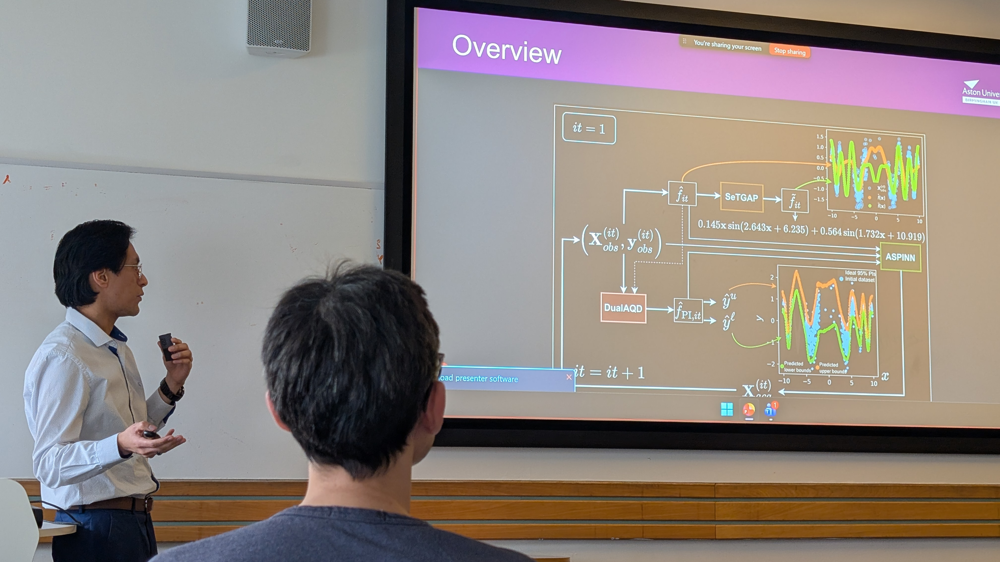
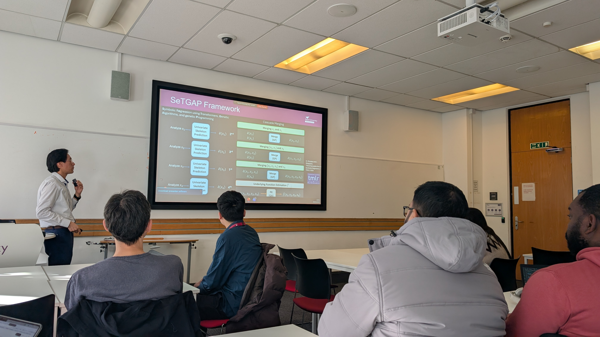
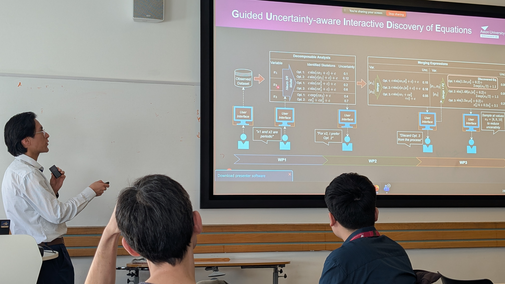

Dr Giorgio Morales is an Aston AI Fellow at Aston University and is a member of ACAIRA. He specializes in Symbolic Regression, Explainable and Interpretable Machine Learning, and Uncertainty Quantification. He earned a Ph.D. in Computer Science at Montana State University in 2025. He holds an M.S. in Computer Science from Montana State University and a B.S. in Mechatronic Engineering from the National University of Engineering in Peru. His research aims to advance transparent machine learning techniques that support scientific discovery, decision-making under uncertainty, and data-driven exploration across disciplines such as physics, biodiversity, and engineering.

  <iframe src="https://1drv.ms/p/c/c56982f783f2d4b4/IQRJ1W7wozPIRbSydmP4xJIuARL2B_-PHOywcrSXVQ7hrag?em=2&amp;wdAr=1.7777777777777777" frameborder="0" style="position: absolute; top: 0; left: 0; width: 100%; height: 100%;" allowfullscreen="true" mozallowfullscreen="true" webkitallowfullscreen="true"></iframe>

<figure style="display: flex; flex-direction: column; align-items: center;">
    
    <figcaption style="text-align: center; margin-top: 5px; font-style: italic;">
        Speaker: Giorgio Morales.
    </figcaption>
</figure>

<figure style="display: flex; flex-direction: column; align-items: center;">
    
    <figcaption style="text-align: center; margin-top: 5px; font-style: italic;">
        Speaker: Giorgio Morales.
    </figcaption>
</figure>

<figure style="display: flex; flex-direction: column; align-items: center;">
    
    <figcaption style="text-align: center; margin-top: 5px; font-style: italic;">
        Speaker: Giorgio Morales.
    </figcaption>
</figure>